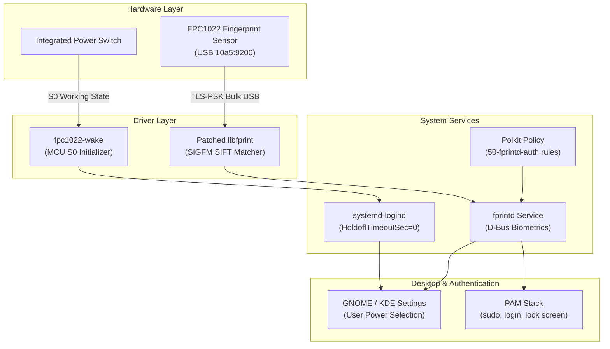

# Xiaomi Mi NoteBook Fingerprint Driver & Power Button Integration

[](#supported-hardware)
[](#supported-hardware)
[](#architecture)
[](LICENSE)

Linux driver and power button integration for the **Fingerprint Cards FPC1022** (`10a5:9200`) sensor found on Xiaomi Mi NoteBook and RedmiBook laptops.

On these devices, the fingerprint reader is physically built into the power button. Under default Linux installations, the sensor lacks an upstream driver, and the power button either feels laggy after waking or triggers unwanted suspends when touched. This repository provides an automated, universal setup for both biometrics and clean power button behavior.

---

## Architecture



---

## Supported Hardware

| Laptop Model | Display | USB ID | Status |
| :--- | :--- | :--- | :--- |
| **Xiaomi Mi NoteBook Ultra** | 15.6" 3.2K 90Hz | `10a5:9200` | Working |
| **Xiaomi Mi NoteBook Pro** | 14" / 15.6" 2.5K | `10a5:9200` | Working |
| **RedmiBook Pro / Max Series** | Various | `10a5:9200` | Working |

Check if your laptop has this sensor:
```bash
lsusb -d 10a5:9200
```
Expected output:
```text
Bus 003 Device 003: ID 10a5:9200 FPC FPC Sensor Controller
```

---

## Quick Install

Open a terminal and run:

```bash
git clone https://github.com/sahid-code404/Xiaomi-Notebook-Ultra-Max-Series-Fingerprint-For-Linux.git
cd Xiaomi-Notebook-Ultra-Max-Series-Fingerprint-For-Linux
sudo ./install.sh
```

Supported distributions:
- **Fedora / RHEL / CentOS** (uses pre-built binaries or builds from source)
- **Ubuntu / Debian / Linux Mint / Pop!_OS**
- **Arch Linux / Manjaro / EndeavourOS**
- **openSUSE / SLES** and generic Linux distributions

### What the installer does:
1. Installs the patched `libfprint` driver with FPC1022 and SIGFM support.
2. Shields the package from being overwritten by routine system updates.
3. Configures `fpc1022-wake` to initialize the power switch on boot and resume.
4. Updates `systemd-logind` so power button presses respond immediately (`HoldoffTimeoutSec=0`) and follow desktop settings.
5. Adds a Polkit rule requiring admin/sudo password verification before deleting or enrolling fingerprints.

---

## Enrolling & Verifying Fingerprints

### 1. Terminal Enrollment
Run the standard enrollment command:
```bash
fprintd-enroll
```
To enroll a specific finger (e.g. right index finger):
```bash
fprintd-enroll -f right-index-finger
```

> **Tip for enrollment**: Standard Linux biometrics take **5 scans**. Slightly vary the angle and edge of your finger across each scan (center pad, fingertip, left edge, right edge, lower base) so recognition matches quickly later.

### 2. Verify Recognition
```bash
fprintd-verify
```

### 3. Desktop GUI
You can also enroll fingerprints through your system settings:
- **GNOME**: Settings → Users → Fingerprint Login
- **KDE Plasma**: System Settings → Users → Fingerprint

### 4. Enable Fingerprint for `sudo` and Login

- **Fedora**:
  ```bash
  sudo authselect enable-feature with-fingerprint
  sudo authselect apply-changes
  ```
- **Ubuntu / Debian**:
  ```bash
  sudo pam-auth-update
  ```
  *(Check "Fingerprint authentication" using the spacebar, then press OK).*
- **Arch Linux**:
  Add `auth sufficient pam_fprintd.so` to the top of `/etc/pam.d/system-auth` and `/etc/pam.d/sudo`.

---

## Power Button Behavior

On Xiaomi laptops, the physical power switch passes through the FPC1022 microcontroller to the motherboard ACPI line:

1. **Instant Response**: On cold boot or waking from suspend, the microcontroller starts asleep until signaled. The installer configures a lightweight helper (`fpc1022-wake`) and sets `HoldoffTimeoutSec=0` in `systemd-logind`, removing systemd's default 30-second post-resume ignore window.
2. **User-Controlled Action**: The installer configures `PowerKeyIgnoreInhibited=no`. When a desktop session is running, the power button action is 100% determined by your preference in **Settings → Power** (Nothing, Suspend, Power Off, or Interactive Dialog). When no session is active (e.g. lock screen or TTY), it defaults to clean shutdown.

---

## How It Works

### Match-on-Host with Encrypted USB Channel
The FPC1022 is a match-on-host sensor, meaning biometric processing happens on the CPU rather than on the sensor chip. To secure raw fingerprint image data in transit over USB, the driver establishes an encrypted **TLS-PSK (Pre-Shared Key)** connection with the sensor hardware before streaming frames.

### SIGFM Biometric Matcher
Standard `libfprint` uses minutiae point matching (NIST NBIS Bozorth3), which requires at least 15–20 distinct ridge endings and bifurcations. Because the FPC1022 sensor has an ultra-compact surface area capturing only **112×88 pixels**, minutiae points are scarce.

The **SIGFM (Scale-Invariant Generalized Feature Matcher)** solves this by extracting OpenCV SIFT keypoint descriptors from upscaled frames. During verification, it runs nearest-neighbor distance ratio matching with geometric consistency filtering to ensure high recognition accuracy and low false-rejection rates.

---

## Uninstallation

To revert all changes, restore stock distribution packages, and clean up configuration files:

```bash
sudo ./uninstall.sh
```

The uninstaller:
- Restores original distribution `libfprint` libraries without removing any system packages.
- Clears package manager exclusion locks.
- Removes power button and Polkit rules.
- Runs package manager `autoremove` at the end to clean up unneeded orphan dependencies.

---

## Building from Source

If you prefer building from source instead of using pre-compiled binaries:

```bash
sudo ./install.sh --build
```

Or manually using Meson and Ninja:

```bash
cd src/libfprint
meson setup build --prefix=/usr --libdir=/usr/lib64 -Ddrivers=all -Ddoc=false -Dintrospection=false
ninja -C build
sudo ninja -C build install
sudo systemctl restart fprintd.service
```

---

## Troubleshooting

- **Sensor not detected in `lsusb`**: Make sure the fingerprint reader is enabled in your laptop BIOS/UEFI settings.
- **`Device was already claimed`**: Restart the background daemon:
  ```bash
  sudo systemctl restart fprintd.service
  ```
- **Check daemon logs**:
  ```bash
  journalctl -u fprintd.service -n 50 --no-pager
  ```

---

## Credits

- **Sergey Subbotin (`ssubbotin`)**: FPC1022 driver implementation and SIGFM matcher.
- **Omkar Chandorkar (`gotenksIN`)**: TLS framing improvements, template handling, and packaging.
- **Jason Huang**: Original sensor reverse engineering and libfprint MR.
- **Natalie Klestrup Röijezon & Tooniis**: SIFT-based small-area biometric research.
- **Sahidul Haque ([@sahid-code404](https://github.com/sahid-code404))**: Power button integration, automated tooling, and packaging for the Xiaomi Linux community.

## License

This project is licensed under the [GNU Lesser General Public License version 2.1](LICENSE) (LGPL-2.1) in accordance with upstream `libfprint`.
