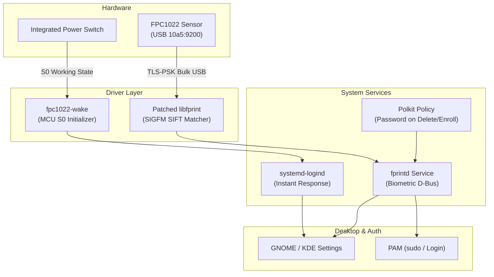

# Xiaomi Fingerprint & Power Button Driver for Linux

[](#supported-hardware)
[](#supported-hardware)
[](#how-it-works)
[](LICENSE)

Automated driver and power button fix for the **FPC1022** (`10a5:9200`) fingerprint reader on **Xiaomi Mi NoteBook** and **RedmiBook** laptops.

---

## Quick Install

Open your terminal and run:

```bash
git clone https://github.com/sahid-code404/xiaomi-fprint-driver.git
cd xiaomi-fprint-driver
sudo ./install.sh
```

**Supported Distributions:** Fedora, Ubuntu, Debian, Arch Linux, openSUSE, Pop!_OS, and Linux Mint.

The installer uses a verified native release package for Fedora, Debian/Ubuntu, and Arch where one is published. It does **not** freeze `libfprint` updates: after an OS, kernel, `fprintd`, OpenSSL, or systemd update, run `fpc1022-doctor` and perform an interactive fingerprint check.

---

## How to Enroll & Verify

### 1. Register Fingerprint
```bash
fprintd-enroll
```
*(Tip: Lift and place your finger at slightly varying angles across the 5 prompts to capture edges and center).*

To enroll a specific finger:
```bash
fprintd-enroll -f right-index-finger
```

### 2. Test Verification
```bash
fprintd-verify
```

### 3. Desktop Settings (GUI)
You can also enroll directly from your desktop settings:
- **GNOME**: Settings → Users → Fingerprint Login
- **KDE Plasma**: System Settings → Users → Fingerprint

### 4. Enable for `sudo` & Login
- **Fedora**: `sudo authselect enable-feature with-fingerprint && sudo authselect apply-changes`
- **Ubuntu / Debian**: `sudo pam-auth-update` (enable Fingerprint authentication)
- **Arch Linux**: Add `auth sufficient pam_fprintd.so` to `/etc/pam.d/system-auth` and `/etc/pam.d/sudo`

---

## Supported Hardware

| Laptop Model | Display | USB ID | Status |
| :--- | :--- | :--- | :--- |
| **Xiaomi Mi NoteBook Ultra** | 15.6" 3.2K 90Hz | `10a5:9200` | Requires physical validation |
| **Xiaomi Mi NoteBook Pro** | 14" / 15.6" 2.5K | `10a5:9200` | Requires physical validation |
| **RedmiBook Pro / Max Series** | Various | `10a5:9200` | Requires physical validation |

Check your sensor with:
```bash
lsusb -d 10a5:9200
```

---

## Power Button Behavior

On Xiaomi laptops, the physical power switch passes through the FPC1022 microcontroller to the motherboard ACPI line:

- **Instant Response**: Removes systemd's default 30-second post-resume ignore delay (`HoldoffTimeoutSec=0`) and ensures the power switch line wakes immediately on boot and resume.
- **Your Choice of Action**: Follows your preference set in **Settings → Power** (Nothing, Suspend, Power Off, or Interactive Menu) without forced overrides. When no user session is active (e.g. lock screen or TTY), it defaults to clean power off.

---

## How It Works (Architecture)



- **TLS-PSK Encryption**: The FPC1022 is a match-on-host sensor. The driver establishes a TLS-PSK (Pre-Shared Key) encrypted USB channel to protect raw biometric image frames during transfer.
- **SIGFM Matcher (OpenCV SIFT)**: The compact $112 \times 88$ px sensor is upscaled once before scale-invariant keypoint extraction and nearest-neighbor matching. Matching accuracy and latency depend on the physical sensor, enrolled prints, OpenCV version, and threshold; verify them on the target laptop.

---

## Uninstallation

To restore official distribution drivers and remove custom configs:

```bash
sudo ./uninstall.sh
```

- Restores stock `libfprint` through the distribution package manager.
- Removes power button rules and Polkit policies.
- Leaves unrelated packages alone; it never runs automatic `autoremove`.

---

## Build from Source

To compile locally instead of using pre-built binaries:

```bash
sudo ./install.sh --build
```

`--build` is intended for development, offline recovery, and unsupported distributions. On Fedora it installs the compiler and OpenCV development dependencies (several GB), so normal installations should use the small release RPM instead. It installs an unmanaged library on distributions without native packaging; prefer the native package path whenever possible.

## Updates and Kernel Changes

This project contains a user-space `libfprint` driver and a small libusb wake helper; it is **not** a kernel module and does not use DKMS. That avoids kernel-module ABI breakage, but no project can guarantee future kernel, firmware, USB, systemd, `fprintd`, or OpenSSL compatibility.

After a system update and reboot, run:

```bash
fpc1022-doctor
fprintd-verify
```

The doctor command is read-only: it checks sensor presence, library resolution, native package ownership, service state, and whether the running kernel changed since the installation baseline. It cannot prove biometric matching accuracy or suspend/resume behavior; test those on the physical laptop.

---

## Troubleshooting

- **Sensor not showing in `lsusb`**: Ensure the fingerprint reader is enabled in your laptop BIOS/UEFI.
- **`Device was already claimed`**: Run `sudo systemctl restart fprintd.service`.
- **View service logs**: `journalctl -u fprintd.service -n 50 --no-pager`.

---

## Credits & License

- **Sergey Subbotin (`ssubbotin`)**: Core FPC1022 driver and SIGFM matcher.
- **Omkar Chandorkar (`gotenksIN`)**: TLS framing and CI packaging.
- **Jason Huang**: Initial sensor reverse engineering.
- **Natalie Klestrup Röijezon & Tooniis**: SIFT biometric research.
- **Sahidul Haque ([@sahid-code404](https://github.com/sahid-code404))**: Power button integration, automated universal tooling, and maintenance.

Licensed under the [GNU Lesser General Public License v2.1](LICENSE) (LGPL-2.1).
